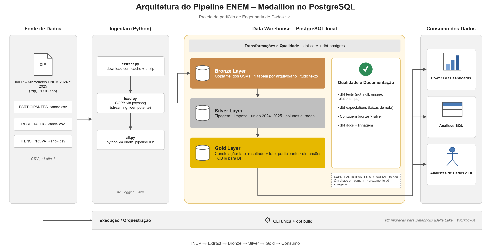

# ENEM Data Pipeline

Pipeline de engenharia de dados que transforma os microdados públicos do **ENEM 2024 e 2025** (INEP) em tabelas modeladas e prontas para análise, usando **arquitetura medallion** (bronze → silver → gold) no PostgreSQL.

> **Status:** em desenvolvimento. Fundação (M0) e extração dos dados do INEP (M1) concluídas; próximas etapas no [roadmap](#roadmap).

## Sumário

- [Sobre o projeto](#sobre-o-projeto)
- [Arquitetura](#arquitetura)
- [Stack](#stack)
- [Como rodar](#como-rodar)
- [Estrutura do repositório](#estrutura-do-repositório)
- [Decisões técnicas](#decisões-técnicas)
- [Roadmap](#roadmap)

## Sobre o projeto

O INEP publica todo ano os microdados do ENEM: arquivos CSV que chegam a **~2 GB por ano**, em `latin-1`, separados por `;` e sem tipagem. Do jeito que são distribuídos, não estão prontos para análise.

Este projeto constrói um pipeline que:

1. **Extrai** os arquivos oficiais do INEP automaticamente (download em streaming e extração seletiva, com cache)
2. **Carrega** os dados brutos no PostgreSQL com `COPY`, de forma idempotente
3. **Transforma** em camadas com dbt: limpeza e tipagem (silver) e modelo dimensional (gold)
4. **Entrega** tabelas prontas para analistas e ferramentas de BI

## Arquitetura



| Camada | Schema | Conteúdo | Ferramenta |
|---|---|---|---|
| **Bronze** | `bronze` | Cópia fiel dos CSVs do INEP: uma tabela por arquivo/ano, todas as colunas como texto | Python + `COPY` |
| **Silver** | `silver` | Dados tipados, limpos, com 2024 e 2025 unidos e colunas curadas | dbt |
| **Gold** | `gold` | Modelo dimensional (constelação) e tabelas largas (OBTs) para BI | dbt |

## Stack

| Ferramenta | Uso |
|---|---|
| **Python 3.12** | Extração e carga (camada bronze) |
| **uv** | Gerenciamento do ambiente e das dependências |
| **requests + truststore** | Download dos microdados do INEP com retry e validação de certificado pelo sistema operacional |
| **zipfile-inflate64** | Suporte a Deflate64 na extração do `.zip` do INEP |
| **psycopg 3** | Conexão com o PostgreSQL e carga via `COPY` |
| **PostgreSQL 16** | Data warehouse local (schemas bronze, silver e gold) |
| **dbt-core** | Transformações silver e gold, testes e documentação _(em breve)_ |

## Como rodar

### Pré-requisitos

- [uv](https://docs.astral.sh/uv/) instalado
- PostgreSQL 16 rodando localmente
- Git

### Passo a passo

```bash
# 1. Clonar o repositório
git clone https://github.com/santoseduardo023/etl-enem.git
cd etl-enem

# 2. Criar o ambiente e instalar as dependências (lê pyproject.toml + uv.lock)
uv sync

# 3. Configurar as credenciais do banco
cp .env.example .env        # no PowerShell: Copy-Item .env.example .env
# edite o .env e preencha POSTGRES_PASSWORD

# 4. Criar o database e os schemas bronze/silver/gold (idempotente)
uv run python -m enem_pipeline.setup_db

# 5. Baixar os microdados do ENEM 2025 (~988 MB) e extrair os CSVs
uv run python -c "from enem_pipeline.extract import download_zip, extract_csvs; download_zip(2025); extract_csvs(2025)"
```

> Download e extração usam cache: arquivos já completos em `data/raw/` e `data/extracted/` não são processados de novo. A carga na bronze e um comando único para o pipeline inteiro entram no M2 (ver [roadmap](#roadmap)).

## Estrutura do repositório

```
etl-enem/
├── src/enem_pipeline/     # código Python do pipeline
│   ├── config.py          # leitura e validação do .env, pastas e URLs do INEP
│   ├── db.py              # conexão com o PostgreSQL
│   ├── setup_db.py        # cria database e schemas
│   ├── extract.py         # download e extração dos CSVs do INEP
│   ├── load.py            # carga na bronze com COPY
│   └── cli.py             # comando único do pipeline
├── sql/                   # scripts SQL (DDL dos schemas)
├── dbt/models/            # transformações: staging, silver e gold
├── docs/                  # diagrama e decisões de arquitetura
├── tests/                 # testes automatizados
├── data/                  # dados do INEP, fora do Git (raw/ e extracted/)
├── .env.example           # modelo de configuração
└── pyproject.toml         # dependências do projeto
```

## Decisões técnicas

**Arquitetura medallion com um schema por camada.** Separa responsabilidades (dado bruto, limpo e modelado) e facilita a futura migração para o Databricks, onde cada camada vira um schema no Unity Catalog.

**Bronze como cópia fiel, tudo em texto.** A bronze não interpreta nada: guarda exatamente o que veio do INEP. A tipagem e a limpeza acontecem na silver, onde podem ser testadas e reprocessadas sem baixar os arquivos de novo.

**Download em streaming, com cache e escrita atômica.** O arquivo de ~1 GB é baixado em pedaços de 1 MB, sem ocupar memória. O download é gravado num `.part` e só vira `.zip` quando termina e o tamanho confere com o `Content-Length` do servidor. Assim, um `.zip` em `data/raw/` é sempre um arquivo completo, e o cache pode confiar nele.

**Conexão com o servidor do INEP.** O servidor de download só suporta até TLS 1.2, derruba conexões de forma intermitente e não envia a cadeia completa de certificados. O extract usa um adaptador HTTP específico para o INEP: limita o TLS a 1.2, valida o certificado com o repositório do sistema operacional (`truststore`) e repete as tentativas com backoff exponencial. A verificação do certificado nunca é desligada.

**Extração seletiva e Deflate64.** Do `.zip` são extraídos só os 3 CSVs de dados, localizados por padrão de nome (`DADOS/<TIPO>_<ano>.csv`), e não por caminho fixo. A extração também usa cache e escrita atômica. O INEP comprime o `RESULTADOS` (~2 GB) com Deflate64, método que o `zipfile` do Python não suporta; o suporte vem da biblioteca `zipfile-inflate64`.

**Carga com `COPY` em vez de pandas.** O `COPY` é o mecanismo nativo do PostgreSQL para carga em massa: envia o arquivo em streaming, sem montar DataFrames em memória, e é muito mais rápido que `INSERT`s gerados pelo `to_sql`.

**Restrição da LGPD na modelagem.** Desde 2024, os arquivos `PARTICIPANTES` (perfil socioeconômico) e `RESULTADOS` (notas) **não têm chave em comum**, por decisão do INEP para proteger a identidade dos participantes. Por isso, a gold usa uma **constelação com dois fatos** (`fato_participante` e `fato_resultado`) que só se cruzam de forma agregada (por município, UF e ano), nunca linha a linha.

**Escopo 2024–2025.** São as duas edições com o mesmo layout simplificado de microdados, o que permite unir os anos na silver sem harmonização complexa.

**Idempotência.** Todos os scripts podem ser executados várias vezes sem duplicar dados nem gerar erro (`IF NOT EXISTS`, cache de download e extração, recarga dentro de transação).

**Credenciais fora do código.** Configurações ficam no `.env` (ignorado pelo Git), com validação na inicialização e mensagem clara se faltar alguma variável.

## Roadmap

- [x] **M0 – Fundação:** estrutura, ambiente com uv, configuração via `.env`, database e schemas
- [x] **M1 – Extract:** download dos microdados do INEP com cache e extração seletiva dos CSVs
- [ ] **M2 – Load bronze:** carga com `COPY`, idempotente e com logging
- [ ] **M3 – Inclusão de 2024:** carga e validação de layout entre os anos
- [ ] **M4 – dbt silver:** tipagem, limpeza, união dos anos e testes básicos
- [ ] **M5 – dbt gold:** modelo dimensional (constelação), OBTs e testes de qualidade
- [ ] **M6 – Acabamento:** pytest, ruff, CI no GitHub Actions e documentação final
- [ ] **v2 – Databricks:** migração para Delta Lake com orquestração em Workflows